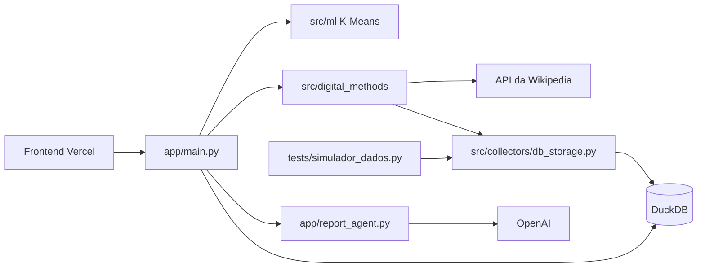

# Codebase Map

API FastAPI (projeto em português) sobre um arquivo **DuckDB** local. Duas frentes:

1. **Painel de marketing** com dados sintéticos de GA4 / Search Console (simulador em `tests/simulador_dados.py`).
2. **Métodos digitais** com dados reais da Wikipedia (`src/digital_methods/`). Ver [METODOS_DIGITAIS.md](METODOS_DIGITAIS.md).

Deploy da API no Render (`https://siteup.onrender.com`). O frontend Next.js é outro repositório, na Vercel.



## Diretórios

```
app/main.py              Todas as rotas HTTP, SQL, orquestração do relatório, admin
app/report_agent.py      create_report_agent() -> Agno Agent (OpenAI, output_schema)
app/report_models.py     Modelos do relatório + format_* (montam o prompt)
src/collectors/db_storage.py   GA4DatabaseStorage: schema, inserts, query_df, save_wiki
src/digital_methods/wikipedia.py   Coletor (requests): revisões, links, pageviews, edições
src/digital_methods/analysis.py    Análises puras em pandas + LEITURAS (ressalvas)
src/ml/                  ChannelProfiler, KeywordClusterer (StandardScaler + KMeans)
src/cleaning/            Limpeza/deduplicação usadas pelo storage
tests/test_api.py        pytest, TestClient, usa o DuckDB real (precisa estar populado)
tests/test_digital_methods.py   pytest, banco temporário, sem rede (1 teste ao vivo opcional)
tests/simulador_dados.py Gerador sintético (TAMBÉM importado em produção por populate-database)
data/processed/ga4_data.duckdb   Banco versionado (sintético + coleta da Wikipedia)
```

## Rotas (`app/main.py`)

| Método | Rota | Faz |
|---|---|---|
| GET | `/health` | `{"status":"ok"}` |
| GET | `/api/v1/overview/kpis` | cards do painel |
| GET | `/api/v1/analysis/correlation_matrix` | correlação entre métricas diárias |
| GET | `/api/v1/ml/channel_clusters` | traffic → `ChannelProfiler` |
| GET | `/api/v1/ml/keyword_clusters` | gsc_query_performance → `KeywordClusterer` |
| POST | `/api/v1/digital-methods/wikipedia/collect` | coleta real → `save_wiki` (usa `ADMIN_KEY` se definida) |
| GET | `/api/v1/digital-methods/wikipedia/edit-history` | `analysis.edit_history_profile` |
| GET | `/api/v1/digital-methods/wikipedia/controversy` | ranking por reversão na era das tags |
| GET | `/api/v1/digital-methods/wikipedia/link-network` | `analysis.link_network` |
| GET | `/api/v1/digital-methods/wikipedia/editions` | edições linguísticas da semente |
| GET | `/api/v1/digital-methods/search/rank-effect` | `analysis.rank_effect` |
| GET | `/api/v1/digital-methods/search/query-network` | `analysis.query_term_network` |
| GET | `/api/v1/data/all`, `/api/v1/data/summary` | amostras e agregados das tabelas |
| POST | `/api/v1/reports/generate` | chama handlers in-process → `format_*` → agente; fallback simples em erro |
| POST | `/api/v1/admin/populate-database` | gera dados sintéticos (usa `ADMIN_KEY` se definida) |
| GET | `/api/v1/admin/database-stats` | contagens |

## Tabelas

| Tabela | Escrita por | Lida por |
|---|---|---|
| `traffic`, `conversions`, `engagement` | simulador / populate-database | kpis, correlação, channel_clusters, data/* |
| `gsc_query_performance` | simulador / populate-database | keyword_clusters, search/rank-effect, search/query-network |
| `gsc_page/country/device/date_performance` | só o CLI do simulador | data/* |
| `wiki_pages`, `wiki_revisions`, `wiki_links`, `wiki_editions` | `wikipedia/collect` → `save_wiki` | rotas `wikipedia/*`, relatório |

`wiki_pages` e `wiki_links` pertencem à semente (chave inclui `seed`); `wiki_revisions` pertence ao artigo.
`wiki_revisions.tags` é texto separado por `|`; `timestamp` é UTC sem fuso.

## Convenções

- Português em docs, comentários e várias chaves JSON; tabelas/colunas em inglês snake_case.
- Rotas: `try/except Exception -> HTTPException(500)`, SQL via `get_db().query_df()`; entrada do usuário em SQL sempre por parâmetro (`conn.execute(sql, [params])`).
- Rotas de métodos digitais devolvem `leitura_do_meio` (texto em `analysis.LEITURAS`).
- Rodar tudo da raiz do repositório (o caminho do banco é relativo).
- Chamar um handler direto de outro (como o relatório faz): passe todos os argumentos; os defaults `Query()` não se resolvem.

## Como mexer

- **Nova análise de métodos digitais**: função pura em `analysis.py` + ressalvas em `LEITURAS` + rota em `main.py` + teste em `tests/test_digital_methods.py`.
- **Novo objeto coletado**: `fetch_*` em `wikipedia.py` (sempre via `_query`/`_get`, que cuidam de paginação e limite), tabela em `_create_tables`, gravação em `save_wiki`.
- **Relatório de IA**: persona/instruções em `report_agent.py`; prompt em `generate_report` + `format_*`.
- **Mudar formato de resposta**: o frontend na Vercel depende disso — avise.

## Pegadinhas

- Sem `ADMIN_KEY`, `populate-database` (com `overwrite`) e `wikipedia/collect` ficam abertos. Demais rotas não têm autenticação nem rate limit.
- Disco do Render é efêmero: o banco volta ao estado versionado a cada deploy.
- Wikipedia: 200 req/min com `User-Agent` identificado, 10 req/min sem. Em 429 o coletor espera o `Retry-After`.
- `rev_limit` pega as revisões mais recentes: janelas de tempo diferentes por artigo. Compare taxas só pela era das tags.
- Mudou o esquema de uma tabela `wiki_*`? `CREATE TABLE IF NOT EXISTS` não migra: dropar a tabela no banco versionado e recoletar.
- Matar o servidor à força deixa um `.wal` ao lado do banco (ignorado pelo git); abrir e fechar o banco consolida.
- `period_days` do relatório é cosmético (não filtra datas). `agent.run()` é síncrono dentro de `async def`.
- KPI de bounce rate (`get_kpis`) não é uma taxa de rejeição real.
- Caminho de ingestão por JSON (`insert_from_json`) provavelmente quebrado; não é usado.
- Segredos antigos continuam no **histórico** do git (`credentials.json`, chaves em docs apagados): devem ser revogados.
