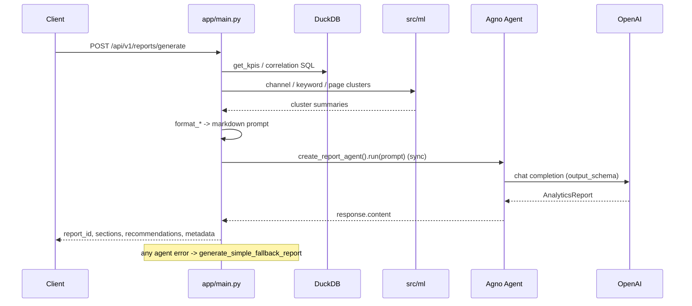
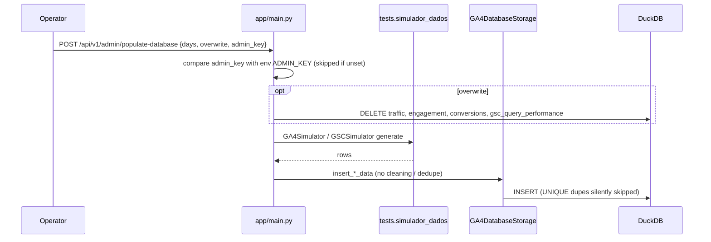

# Codebase Map

> Auto-generated by Cartographer. Last mapped: 2026-11-16T20:36:34Z

## System Overview

A FastAPI analytics API (Portuguese-language project) over a local **DuckDB** file. Real GA4 / Search Console collection is **disabled** (stubs raise `NotImplementedError`); data comes from a **synthetic simulator** (`tests/simulador_dados.py`). Endpoints serve KPIs, correlations, K-Means clusters (scikit-learn), a heuristic what-if simulator, raw data dumps, and an **AI report** generated by an Agno agent on OpenAI. Deployed to Render (https://siteup.onrender.com). The **frontend** (Next.js dashboard) lives outside this repo and is deployed on **Vercel**; it consumes this API. Its spec is in `docs/PROMPT_PARA_GERAR_FRONTEND.md` and `docs/DOCUMENTACAO_API_PARA_FRONTEND.md`.

```mermaid
graph TB
    subgraph Disabled["GA4 / GSC collection (DISABLED)"]
        GAC[src/ga GA4Client + GA4DataCollector]
        GSCC[src/gsc GSCClient + GSCDataCollector]
        ORC[src/collectors *_orchestrator]
    end
    subgraph Data
        SIM[tests/simulador_dados.py<br/>GA4Simulator / GSCSimulator]
        STORE[src/collectors/db_storage.py<br/>GA4DatabaseStorage]
        CLEAN[src/cleaning<br/>cleaner / dedupe / validators]
        DB[(DuckDB<br/>data/processed/ga4_data.duckdb)]
    end
    subgraph API["app/ (FastAPI)"]
        MAIN[app/main.py — 13 routes]
        ML[src/ml K-Means<br/>Channel / Keyword / Page]
        RM[app/report_models.py<br/>Pydantic + prompt formatters]
        AG[app/report_agent.py<br/>Agno Agent]
    end
    OAI[[OpenAI gpt-5-mini]]
    FE[Frontend Next.js<br/>Vercel, separate repo]
    FE -->|HTTP| MAIN
    GAC --> ORC
    GSCC --> ORC
    ORC -. JSON .-> STORE
    SIM --> STORE
    STORE --> CLEAN
    STORE --> DB
    MAIN -->|get_db().query_df| DB
    MAIN --> ML
    MAIN -->|/admin/populate-database| SIM
    MAIN --> RM
    MAIN --> AG
    AG --> OAI
```

## Directory Structure

```
app/                     FastAPI application (everything HTTP lives here)
  main.py                All 13 routes, SQL, ML glue, report orchestration, admin
  report_agent.py        create_report_agent() -> Agno Agent (OpenAI, output_schema)
  report_models.py       ReportRequest / AnalyticsReport models + format_* prompt builders
  start_api.sh           Local dev launcher (stale dependency + endpoint list)
  README.md              Stale (documents 5 endpoints)
src/
  collectors/db_storage.py   GA4DatabaseStorage: DuckDB schema, inserts, queries
  collectors/*_orchestrator  Dead (raise NotImplementedError)
  cleaning/              Row cleaners, deduplicator, validators (only partly wired in)
  ga/, gsc/              Disabled Google API clients (imports commented out)
  ml/                    ChannelProfiler, KeywordClusterer, PageSegmenter (StandardScaler+KMeans)
tests/
  test_api.py            Real pytest (TestClient, in-process, needs populated DB)
  test_report_endpoint.py pytest-ish, may call OpenAI
  test_ml_endpoints.py   Script; needs server on localhost:8000
  test_api_simulador.py  Script; needs server on localhost:8000
  simulador_dados.py     Synthetic data generator (ALSO imported by production code)
  create_test_data.py    Small fixture loader
  cleanup_test_data.py   DELETE FROM 5 tables (whole tables!)
  visualizar_dados*.py   Read-only inspectors
data/processed/          DuckDB file (untracked, not gitignored)
data/raw/                JSON dumps (legacy GA4 format)
docs/                    31 Portuguese docs — many stale (see Navigation Guide)
sql/migrations/          Empty
_backup_arquivos_obsoletos/  Obsolete GA4-era scripts + tracked credentials.json
.github/workflows/ci.yml Placeholder comment only — no CI
```

## Module Guide

### app/main.py — the API

**Purpose**: Single FastAPI app; every handler is `try/except Exception -> HTTPException(500, str(e))`, raw SQL via `get_db().query_df()` (lazy global `GA4DatabaseStorage` singleton). CORS `*` with credentials.

| # | Method | Path | Handler | Reads / does | Auth |
|---|---|---|---|---|---|
| 1 | GET | `/health` | `health` | `{"status":"ok"}` | — |
| 2 | GET | `/api/v1/overview/kpis` | `get_kpis` | engagement, traffic, conversions → cards (`sessoesTotais`, …) | — |
| 3 | GET | `/api/v1/analysis/correlation_matrix` | `get_correlation_matrix` | per-date aggregate → pandas `.corr()` | — |
| 4 | GET | `/api/v1/ml/channel_clusters?n_clusters=3` | `get_channel_clusters` | traffic → `ChannelProfiler` | — |
| 5 | GET | `/api/v1/ml/keyword_clusters?n_clusters=4` | `get_keyword_clusters` | gsc_query_performance → `KeywordClusterer` | — |
| 6 | GET | `/api/v1/ml/page_clusters?n_clusters=5` | `get_page_clusters_ml` | engagement → `PageSegmenter` | — |
| 7 | GET | `/api/v1/page_analysis?path=` | `get_page_analysis` | per-page stats + 3-cluster label; 404 if missing | — (**SQL injection**) |
| 8 | POST | `/api/v1/predict/simulator` | `predict_simulator` | heuristic what-if (`contagemDePalavras`, `numeroDeImagens`, `precoDoProduto`) | — |
| 9 | GET | `/api/v1/data/all?limit=10` | `get_all_data` | counts + samples of 8 tables | — |
| 10 | GET | `/api/v1/data/summary` | `get_data_summary` | per-table aggregates | — |
| 11 | POST | `/api/v1/reports/generate` | `generate_report` | calls handlers 2–6 in-process → `format_*` → Agno agent → `AnalyticsReport`, fallback on error | — (costs OpenAI) |
| 12 | POST | `/api/v1/admin/populate-database` | `populate_database` | imports `tests.simulador_dados`, writes 4 tables, optional `overwrite` DELETE | body `admin_key` vs env `ADMIN_KEY`, **open if unset** |
| 13 | GET | `/api/v1/admin/database-stats` | `get_database_stats` | counts of 4 tables | — |

### app/report_agent.py + app/report_models.py — AI reports

- `create_report_agent(debug_mode=False)`: Agno `Agent(model=OpenAIChat("gpt-5-mini-2025-08-07"), output_schema=AnalyticsReport, markdown=True)`; Portuguese "Senior Business Analyst" persona, no tools/memory — all data is in the prompt. New agent per request; raises `ValueError` without `OPENAI_API_KEY` (caught → fallback report).
- `report_models.py`: `ReportRequest` (`period_days`, `focus_areas`, `detail_level`, `language`), `ReportSection`, `Recommendation`, `AnalyticsReport`, `format_kpis/channel_clusters/keyword_clusters/page_clusters/correlations`, `calculate_confidence_score`.

### src/collectors/db_storage.py — storage

**Class**: `GA4DatabaseStorage(db_path="data/processed/ga4_data.duckdb", auto_clean=True, auto_deduplicate=True)` — one persistent `duckdb.connect`, creates schema in `_create_tables`.

- Simulator path (works): `insert_traffic_data`, `insert_conversions_data`, `insert_engagement_data`, `insert_gsc_{query,page,country,device,date}_data` — compute `MAX(id)+1`, plain `INSERT`.
- JSON path (likely broken): `insert_from_json(path)` → `_insert_*_rows`, `INSERT OR REPLACE` without `id`.
- Reads: `query()`, `query_df()`, `get_summary_stats()`, `close()`.

| Table | Written by | Read by |
|---|---|---|
| `traffic` | simulator, populate-database, JSON path | kpis, correlation, channel_clusters, page_analysis, simulator, data/*, db-stats |
| `conversions` | same | kpis, correlation, simulator, data/*, db-stats |
| `engagement` | same | kpis, correlation, page_clusters, page_analysis, simulator, data/*, db-stats |
| `gsc_query_performance` | same | keyword_clusters, data/*, db-stats |
| `gsc_page/country/device/date_performance` | simulator CLI only (not populate-database) | data/* |
| `realtime_traffic`, `gsc_query_page_performance` | JSON path only | `get_summary_stats` only |

### src/cleaning/

`DataCleaner`, `GA4DataCleaner`, `GSCDataCleaner`, `JSONCleaner` (data_cleaner.py); `DeduplicateData` (deduplicator.py); `DataValidator`, `GA4Validator`, `GSCValidator`, `ValidationReport` (validators.py). Stdlib only, dict-in/dict-out, snake_case keys. Only `clean_traffic_row` + traffic dedupe are actually called (JSON path). Validators are not called by storage or API.

### src/ml/

`ChannelProfiler(3)` (sessions, activeUsers, newUsers, screenPageViews, averageSessionDuration + source/medium), `KeywordClusterer(4)` (clicks, impressions, ctr, position + query), `PageSegmenter(5)` (engagement_rate, event_count, average_session_duration + page_path). All: `fit_transform(df)` (mutates df, adds `cluster`), `get_cluster_centers()`, `get_segment_summary(df)`. `StandardScaler` + `KMeans(random_state=42)`, refit every request, no NaN handling.

### src/ga/, src/gsc/, src/collectors/*_orchestrator.py

Disabled. Constructors raise `NotImplementedError`; Google imports commented. Importable but not instantiable. Original output format: `{"metadata": {report_type, ...}, "rows": [...]}`.

### tests/

Only `test_api.py` (and `test_report_endpoint.py`) work under pytest, in-process via `TestClient`, against the real DuckDB file — populate first. `test_ml_endpoints.py` / `test_api_simulador.py` hit hardcoded `http://localhost:8000` and fail under bare `pytest tests/`. Simulator: `python tests/simulador_dados.py --days 30 [--clear]` writes all 8 tables (`PROPERTY_ID="simulado_12345"`, `SITE_URL="https://example.com/"`).

## Data Flow





## Conventions

- **Language**: Portuguese for docs, comments, prints, and many API JSON keys (`sessoesTotais`, `contagemDePalavras`); DB tables/columns in English snake_case (`gsc_` prefix for Search Console).
- **API JSON**: camelCase for frontend endpoints, snake_case on the report path.
- **Errors**: blanket `except Exception -> 500` in handlers; `print()` instead of logging; per-row insert failures swallowed.
- **Imports**: `app/main.py` appends repo root to `sys.path`; scripts in `tests/` do the same — run everything from the repo root.
- **Docs**: `SCREAMING_SNAKE.md` filenames, emoji headings.

## Gotchas

**Security**
- `app/main.py:481-492` — `page_analysis` f-strings `path` into SQL (injection).
- `populate-database` is unauthenticated when `ADMIN_KEY` is unset; with `overwrite=true` anyone can wipe data. `database-stats`, `data/all`, `reports/generate` have no auth/rate limit.
- Secrets committed: `_backup_arquivos_obsoletos/credentials.json` (tracked), an OpenAI-style key in `docs/GUIA_RAPIDO_RENDER.md`, a GA4 API secret in `docs/INSTRUCOES_PARA_PROXIMA_IA.md`.

**Data / storage**
- DB path is hardcoded relative (`data/processed/ga4_data.duckdb`); `DATABASE_PATH`/`DATABASE_URL` in `.env.example` are never read. Working directory matters.
- Render disk is ephemeral → DB resets on redeploy; re-run `populate-database`.
- `populate-database` fills only 4 tables, so `/data/all` and `/data/summary` show empty GSC page/country/device/date tables (errors swallowed by bare `except:`).
- Re-running populate without `overwrite` silently skips UNIQUE duplicates but reports `len(rows)` as inserted.
- JSON ingestion path is likely broken: `INSERT` without `id` (NOT NULL PK), dedupe keys snake_case vs camelCase raw rows (collapses rows), `JSONCleaner` reads top-level `report_type` instead of `metadata.report_type`.
- `cleanup_test_data.py` / `--clear` wipe whole tables, not just test rows.

**API correctness**
- Bounce-rate KPI formula (`main.py:147-154`) is not a real bounce rate.
- `calculate_confidence_score` reads `total_sessions` but KPIs return `sessoesTotais` → data-volume score always 0.
- Report metadata hardcodes `agent_model: "gpt-4o-mini"`, actual model is `gpt-5-mini-2025-08-07`.
- `period_days` is cosmetic — no date filtering.
- `agent.run()` is sync inside `async def` (blocks event loop); `debug_mode=True` hardcoded.
- `get_correlation_matrix` early-return branch uses different keys than normal branch.
- ML: no NaN handling; empty clusters can produce NaN in JSON.
- Production imports `tests.simulador_dados` — `tests/` must be deployed.

**Tooling drift**
- `app/README.md`, `app/start_api.sh` list stale endpoints (`/api/v1/analysis/page_clusters` doesn't exist) and `start_api.sh` omits scikit-learn/agno/openai/dotenv.
- `pyproject.toml` `authors` uses Poetry syntax under `[project]` (invalid); `requires-python >=3.9` is too low for Agno.
- `requirements.txt` still lists unused Google SDKs; all pins are loose `>=` (`agno>=0.3.0` but code needs 2.x API).
- No CI (`ci.yml` is a placeholder). `.gitignore` does not ignore the `.duckdb` file.
- Pydantic v1 idioms (`.dict()`, `class Config`) under Pydantic 2.

## Navigation Guide

**Run locally**: `pip install -r requirements.txt`; `.env` with `OPENAI_API_KEY`, `ADMIN_KEY`; `python -m uvicorn app.main:app --reload --port 8000`; then `POST /api/v1/admin/populate-database` or `python tests/simulador_dados.py --days 30`.
**Run tests**: populate DB, then `python -m pytest tests/test_api.py -v`.
**Add an API endpoint**: `app/main.py` (follow the `get_db().query_df` + try/except pattern); add a test in `tests/test_api.py`; document in `docs/DOCUMENTACAO_API_PARA_FRONTEND.md` and root `README.md`.
**Add / change a table**: `GA4DatabaseStorage._create_tables` + an `insert_*_data` method in `src/collectors/db_storage.py`; generator in `tests/simulador_dados.py`; the `overwrite` DELETE list in `populate_database`; `tests/cleanup_test_data.py`.
**Change ML clustering**: `src/ml/*.py` + the matching handler in `app/main.py` + `format_*` in `app/report_models.py`.
**Change the AI report**: prompt/persona/model in `app/report_agent.py`; schema in `app/report_models.py` (`AnalyticsReport`); orchestration/fallback in `generate_report` in `app/main.py`.
**Re-enable real GA4/GSC**: uncomment `src/ga/*`, `src/gsc/*`, orchestrators; fix the JSON ingestion bugs in `db_storage.py` first.
**Deploy (Render)**: build `pip install -r requirements.txt`, start `uvicorn app.main:app --host 0.0.0.0 --port $PORT`, env `OPENAI_API_KEY`, `ADMIN_KEY`; config lives in the Render dashboard (no render.yaml/Dockerfile).

**Docs worth reading**: root `README.md` → `docs/DOCUMENTACAO_API_PARA_FRONTEND.md` → `docs/README_SIMULADOR.md` → `docs/GUIA_RAPIDO_RENDER.md` → `docs/INTEGRACAO_ML.md` / `docs/IMPLEMENTACAO_RELATORIOS_COMPLETA.md` → `docs/PROMPT_PARA_GERAR_FRONTEND.md` (frontend spec; the frontend itself is on Vercel).
**Change an API response shape**: the Vercel frontend depends on it — update `docs/DOCUMENTACAO_API_PARA_FRONTEND.md` and the frontend together.
**Stale docs (skip)**: `INDICE_DOCUMENTACAO.md`, `ESTADO_ATUAL_PROJETO.md`, `INSTRUCOES_PARA_PROXIMA_IA.md`, `GUIA_RAPIDO.md`, `CONFIGURACAO_COMPLETA.md`, `GERAR_DADOS_TESTE.md`, `COMPARACAO_MEASUREMENT_PROTOCOL.md`, `SUMARIO_VALIDACAO.md`, `GUIA_RAPIDO_SEM_APIS.md`, `CHECKLIST_VALIDACAO.md`, `RESUMO_ALTERACOES.md`, `README_SCRIPTS_DESABILITADOS.md`, `IMPLEMENTACAO.md` (partly), `app/README.md`. Duplicates: `GUIA_RAPIDO_RENDER.md` ≈ `POPULAR_DADOS_PRODUCAO.md`; `README_SIMULADOR.md` ≈ `SIMULADOR_COMPLETO.md` ≈ `RESUMO_EXECU TIVO.md`.
