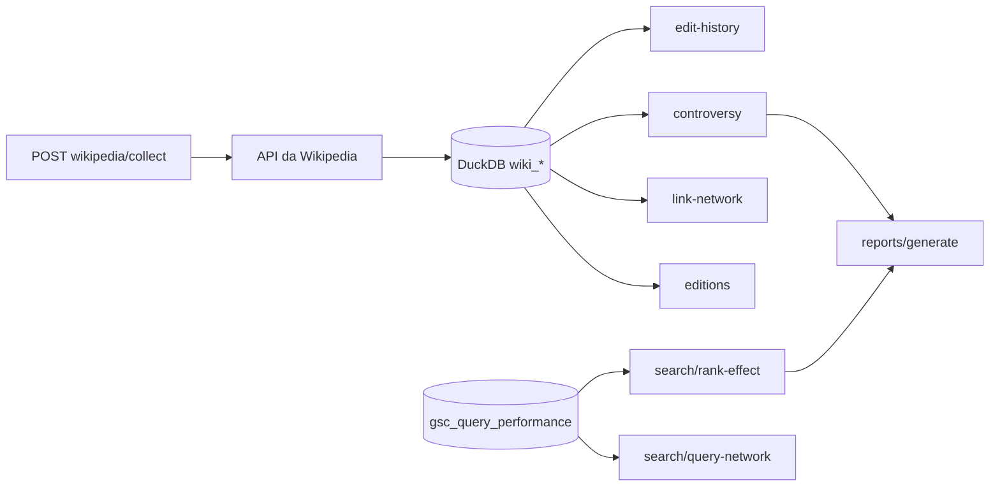

# Métodos Digitais na API

## Ideia

Métodos nativamente digitais (Rogers, *follow the medium*) usam os objetos do próprio meio
— edições, reversões, links, posição no ranking — e tratam o dado como algo **produzido pela
plataforma**, não como retrato neutro do mundo. Por isso toda rota de análise abaixo devolve, junto dos
números, uma lista `leitura_do_meio`: o que aquele número diz sobre a plataforma e o limite
do que ele diz sobre o tema.

| Objeto do meio | Fonte | O que a API faz com ele |
|---|---|---|
| Histórico de edições | Wikipedia (real) | quem edita, concentração, reversões, picos |
| Tag de reversão | Wikipedia (real) | cartografia de controvérsia entre artigos |
| Hiperlink | Wikipedia (real) | rede dirigida entre os artigos do recorte |
| Edição linguística | Wikipedia (real) | o mesmo tema como referência cultural local |
| Posição no ranking | Search Console (simulado) | quanto do clique é efeito da ordenação |
| Consulta de busca | Search Console (simulado) | rede de coocorrência de termos |

## Fluxo



## Rotas (`/api/v1/digital-methods`)

### `POST /wikipedia/collect`

Coleta dados reais e grava no DuckDB. Recoletar a mesma semente substitui o recorte dela;
sementes diferentes podem compartilhar artigos sem interferir uma na outra.

```json
{
  "seed": "Inteligência artificial",
  "lang": "pt",
  "titles": ["ChatGPT", "OpenAI", "Deepfake"],
  "max_pages": 10,
  "rev_limit": 500,
  "edition_langs": ["en", "es", "fr", "de"],
  "admin_key": "obrigatória se ADMIN_KEY estiver definida"
}
```

- **Recorte curado** (`titles`, até 24, sem `|`): semente + a lista. Títulos inexistentes voltam em `not_found`; redirects são resolvidos.
- **Recorte automático** (sem `titles`): semente + artigos com **link recíproco** com ela, ordenados por pageviews dos últimos 30 dias, até `max_pages`. Rápido para explorar, mas puxa páginas populares e periféricas.
- `rev_limit`: revisões **mais recentes** por artigo (50–2000). A janela de tempo varia de artigo para artigo.
- Leva de 30 s a 1 min para ~10 artigos. Erros: `404` semente inexistente, `403` chave errada, `502` falha na Wikipedia.

### `GET /wikipedia/edit-history?title=&lang=pt`

Perfil de um artigo: `total_edits`, `unique_editors`, `sample_window`, `actor_shares`
(registered / anon / bot / hidden), `interface_shares` (visualeditor, mobile), `concentration`
(gini, top_editor_share, top10pct_share), `reverts`, `top_editors`, `timeline` mensal
(meses sem edição entram como zero) e `bursts` (meses acima de média + 2 desvios).

Em `reverts`: `revert_rate` é sobre a amostra inteira; `revert_rate_tagged_era` só conta
edições desde `tagged_era_start` — use esta para comparar. A era é a do corpus inteiro
(a mesma da rota de controvérsia), não a do artigo.

### `GET /wikipedia/controversy?lang=pt&seed=&min_edits=20`

Artigos coletados ordenados por taxa de reversão. **Todas** as colunas (reversão, anônimos,
robôs, concentração, picos) contam só edições desde `plataforma.tag_era_start`: a primeira
tag de reversão (`mw-reverted` ou `mw-manual-revert`) observada no corpus. É a data observada
na amostra, um limite superior para quando a plataforma passou a etiquetar — não a data oficial.

- `edits_in_tag_era` / `edits_sampled`: quantas edições entram na conta, de quantas coletadas.
- `low_sample`: menos de `min_edits` edições na era. A taxa é instável e o artigo vai para o fim.
- `plataforma.last_anon_edit`: quando a edição anônima some do corpus.

### `GET /wikipedia/link-network?lang=pt&seed=`

`nodes` (id, in_degree, out_degree), `edges` (source, target, reciprocal), `density`, `reciprocity`.
Use sempre com `seed`: links só são coletados dentro do recorte de cada semente, então a
rede sem filtro junta recortes e subestima a densidade.

### `GET /wikipedia/editions?title=&lang=pt`

A semente em cada edição linguística: `length`, `pageviews_30d`, `pageviews_share`.

### `GET /search/rank-effect`

`curve` (CTR por posição), `top3_click_share`, `top3_impression_share`, `spearman_position_ctr`.

### `GET /search/query-network`

`nodes` (`id` = termo, queries, impressions, clicks) e `edges` (source, target, `weight` =
consultas em que aparecem juntos, impressions).

## O que os dados reais já mostraram

Coleta de 12 artigos em torno de "Inteligência artificial" (pt.wikipedia, nov/2026), que acompanha o banco:

- **O meio muda de regra no meio da série.** A última edição anônima do corpus é de
  12/08/2020; três minutos depois aparece a primeira tag de reversão. Dali em diante, 0% de
  anônimos nos 12 artigos. Na amostra inteira de "Inteligência artificial" eles são 20%.
  "Anônimos não são revertidos" seria uma leitura errada: são regras da plataforma
  (quem pode editar, o que é etiquetado), não comportamento.
- **Disputa e atenção não são a mesma coisa.** ChatGPT tem 207 mil pageviews e 23,7% de
  reversão (295 edições); "Inteligência artificial" tem 19 mil pageviews e 21,9% (256 edições).
- **Artigos de um dono só.** Em "Aprendizagem profunda", um único editor fez 70% das 54
  edições, com 0% de reversão. Consenso aparente pode ser ausência de disputa.
- **Amostra pequena engana.** "Viés algorítmico" tem 6 edições; a API marca `low_sample`.
- **Referência cultural local.** A edição em inglês concentra 72% dos pageviews do tema entre
  as cinco edições comparadas; a em português, 3%.

## Limites

- Dados de busca são **sintéticos** (simulador): a curva de CTR reflete o modelo do simulador.
- A Wikipedia limita a 200 requisições/min com `User-Agent` identificado (padrão: URL do
  repositório; troque com `WIKIPEDIA_USER_AGENT`). O coletor espaça as chamadas e respeita `Retry-After`.
- "Bot" é quem tem a flag hoje; "editores únicos" conta contas, não pessoas.
- Sem visualização: a API entrega nós e arestas; desenhar a rede é trabalho do frontend.
